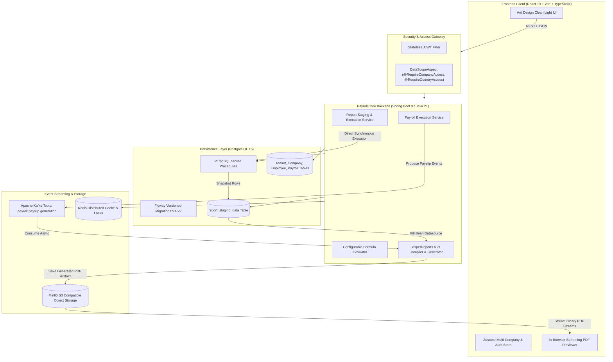

# 🏢 Enterprise Multi-Tenant Payroll & Statutory Compliance Platform

[](https://www.oracle.com/java/)
[](https://spring.io/projects/spring-boot)
[](https://react.dev/)
[](https://www.typescriptlang.org/)
[](https://www.postgresql.org/)
[](https://kafka.apache.org/)
[](https://min.io/)
[](https://community.jaspersoft.com/)
[](LICENSE)

> A production-ready, distributed, multi-tenant enterprise payroll calculation, statutory compliance, and document generation platform engineered with **Java 21, Spring Boot, PostgreSQL, Apache Kafka, MinIO, JasperReports**, and **React 19 + TypeScript**.

---

## 🌟 Executive Summary

The **Enterprise Payroll Platform** is built to solve complex international payroll operations for multi-subsidiary conglomerates. It provides multi-tenant data isolation, role-based geographic and legal entity scoping, configurable statutory component calculation engines, asynchronous document generation pipelines, and an audit-ready reporting framework with in-browser high-fidelity PDF previews.

---

## 🏗️ System Architecture



---

## 🚀 Key Features

### 1. 🏢 Multi-Tenant & Multi-Subsidiary Isolation
- **Tenant & Entity Scoping**: Manage multiple distinct parent tenants and international operating subsidiaries (e.g., *Acme Corp US, Acme India Ltd, Aj Pvt Ltd*).
- **AOP Security Decorators**: Automatic method-level authorization checking via `@RequireCompanyAccess` and `@RequireCountryAccess` ensuring users only access permitted legal entities.

### 2. 🧮 Configurable Component & Compensation Engine
- Dynamic compensation structure with formula-driven earnings and deductions:
  - **Basic Pay**: Percentage of base salary (`#BASE_SALARY * 0.40`).
  - **House Rent Allowance (HRA)**: Configurable formulas (`Basic Pay * 0.50`).
  - **Statutory Deductions**: Provident Fund (PF at 12%), Employee State Insurance (ESI), Professional Tax, and Income Tax (TDS).
  - **Employee Overrides**: Custom salary component overrides for specific employees without altering global templates.

### 3. ⚡ High-Throughput Batch Payroll Processing
- Idempotent monthly payroll calculation runs per subsidiary.
- Full line-item breakdown calculated and stored with zero rounding divergence.
- Event-driven payslip dispatch via **Apache Kafka** (`payroll.payslip.generation`) for asynchronous, decoupled PDF rendering.

### 4. 📊 3-Tier Enterprise Staging & Reporting Engine
Designed after tier-1 ERP systems (SAP / Oracle HCM):
1. **Dynamic Parameter Catalog**: Interactive catalog supporting multiple statutory report types.
2. **PostgreSQL Staging Procedures**: High-performance PL/pgSQL procedures (`sp_populate_payslip_staging`, `sp_populate_payroll_summary_staging`, `sp_populate_headcount_cost_staging`) snapshot isolated report partitions into `report_staging_data` with unique job IDs.
3. **JasperReports 6.21 Engine**: Pre-compiled JRXML templates (`payslip_template.jrxml`, `payroll_summary_template.jrxml`, `headcount_cost_template.jrxml`) dynamically filled via staged Java Bean collections.
4. **MinIO Cloud Storage**: Generated artifacts are securely persisted into isolated MinIO S3 buckets.
5. **In-Browser Streaming Preview & Export**: Streaming binary PDF renderer into `<iframe />` with instant **Export PDF** download.

---

## 🛠️ Technology Stack

| Domain | Technology | Description |
|---|---|---|
| **Language** | Java 21 (LTS) | Modern Java with records, pattern matching, virtual threads readiness |
| **Backend Framework** | Spring Boot 3.4+ | Web, Data JPA, Security 6, Kafka, Actuator |
| **Database** | PostgreSQL 16 | Relational database with PL/pgSQL stored procedures & indexes |
| **Database Migrations**| Flyway | Automated versioned schema management (V1 to V7) |
| **Messaging** | Apache Kafka | Asynchronous event-driven payslip generation pipeline |
| **Cache & Session** | Redis 7 | Distributed cache & token metadata store |
| **Document Engine** | JasperReports 6.21 | Pixel-perfect statutory PDF document compilation & rendering |
| **Object Storage** | MinIO | High-performance, S3-compatible cloud object store |
| **Frontend Framework** | React 19 + TypeScript | Strict typing, Hooks, modern component architecture |
| **Build Tools** | Maven & Vite | Blazing fast HMR and optimized production bundles |
| **Design System** | Ant Design 5 + Custom CSS | Bright, accessible modern enterprise UX palette |

---

## 🗄️ Database Architecture & Flyway Migrations

The platform utilizes Flyway for zero-downtime, immutable schema versioning:

- **`V1__init_schema.sql`**: Core multi-tenant architecture (`tenant`, `country`, `company`, `department`, `employee`, `app_user`).
- **`V2__salary_components.sql`**: Configurable salary components, calculation types, formula expressions, and employee salary structure overrides.
- **`V3__payroll_execution.sql`**: `payroll_batch`, `payroll_record`, and audit detail tables with status state machine (`DRAFT` &rarr; `PENDING` &rarr; `PROCESSING` &rarr; `COMPLETED`).
- **`V4__seed_data.sql`**: Comprehensive Indian & international subsidiaries, departments, employees, and base compensation packages.
- **`V5__company_hr_support.sql`**: Granular subsidiary scopes and multi-company user role mapping.
- **`V6__aj_pvt_ltd_seed.sql`**: Production-grade enterprise demo seed for **Aj Pvt Ltd** with realistic executive and engineering headcount.
- **`V7__reporting_tables.sql`**: Staging infrastructure `report_staging_data` and PL/pgSQL stored procedures for asynchronous and batch reporting.

---

## 📄 Available Enterprise Reports

| Report Code | Title | Category | Description | Staging Procedure | Output |
|---|---|---|---|---|---|
| `EMP_PAYSLIP` | **Employee Monthly Payslip** | Payroll | Itemized statutory payslip showing basic salary, allowances, PF/tax deductions, and take-home pay. | `sp_populate_payslip_staging` | PDF |
| `PAYROLL_SUMMARY` | **Company Payroll Master Register** | Audit & Financials | Comprehensive company-wide payroll register detailing all employee disbursements, PAN, bank accounts, and batch totals. | `sp_populate_payroll_summary_staging` | PDF |
| `HEADCOUNT_COST` | **Department Cost & Headcount** | Analytics | Departmental allocation of active headcount, cumulative base salary expenditure, and average salary benchmarks. | `sp_populate_headcount_cost_staging` | PDF |

---

## 🚦 Getting Started

### Prerequisites
- **JDK 21** or later installed
- **Node.js 18+** & npm installed
- **Docker & Docker Compose** installed and running

### 1. Clone Repository
```bash
git clone https://github.com/Ajaykumarkuppusamy/payroll.git
cd payroll
```

### 2. Start Infrastructure Containers
Start PostgreSQL, Redis, Kafka, and MinIO via Docker:
```bash
docker run -d --name payroll_db -p 5433:5432 -e POSTGRES_DB=payroll_db -e POSTGRES_USER=payroll_admin -e POSTGRES_PASSWORD=changeme postgres:16
docker run -d --name payroll_redis -p 6379:6379 redis:7-alpine
docker run -d --name payroll_kafka -p 9092:9092 -e KAFKA_CFG_NODE_ID=1 -e KAFKA_CFG_PROCESS_ROLES=broker,controller -e KAFKA_CFG_LISTENERS=PLAINTEXT://:9092,CONTROLLER://:9093 -e KAFKA_CFG_ADVERTISED_LISTENERS=PLAINTEXT://localhost:9092 -e KAFKA_CFG_LISTENER_SECURITY_PROTOCOL_MAP=CONTROLLER:PLAINTEXT,PLAINTEXT:PLAINTEXT -e KAFKA_CFG_CONTROLLER_QUORUM_VOTERS=1@localhost:9093 -e KAFKA_CFG_CONTROLLER_LISTENER_NAMES=CONTROLLER bitnami/kafka:latest
docker run -d --name payroll_minio -p 9000:9000 -p 9001:9001 -e MINIO_ROOT_USER=minioadmin -e MINIO_ROOT_PASSWORD=minioadmin minio/minio server /data --console-address ":9001"
```

### 3. Launch Backend API
```bash
cd enterprise-payroll-api
mvn clean package -DskipTests
java -jar target/aj-0.0.1-SNAPSHOT.jar
```
*The Spring Boot server will boot on port `8080`, automatically execute Flyway migrations, initialize the MinIO `payroll-payslips` bucket, and pre-compile all Jasper templates.*

### 4. Launch Frontend UI
```bash
cd enterprise-payroll-ui
npm install
npm run dev
```
*Access the UI at `http://localhost:5173`.*

---

## 🔐 Default Demo Credentials

| Role | Username / Email | Password | Access Scope |
|---|---|---|---|
| **Super Admin** | `admin` *(admin@acme.com)* | `password123` | Global (All Companies & Countries) |
| **HR Manager India** | `hr_india` *(hr_india@acme.com)* | `password123` | Acme India & Aj Pvt Ltd |

---

## 📡 Key REST API Specifications

| Method | Endpoint | Description | Authorization |
|---|---|---|---|
| `POST` | `/api/v1/auth/login` | Authenticate operator & retrieve scoped JWT | Public |
| `GET` | `/api/v1/companies/{companyId}/dashboard` | Real-time headcount & payroll metrics | Scoped JWT |
| `GET` | `/api/v1/companies/{companyId}/employees` | Search & list active employees | Scoped JWT |
| `POST` | `/api/v1/companies/{companyId}/payroll/run` | Trigger monthly payroll calculation batch | Scoped JWT |
| `GET` | `/api/v1/companies/{companyId}/payroll/batches` | List completed payroll runs & batch history | Scoped JWT |
| `GET` | `/api/v1/reports/catalog` | List available Jasper statutory reports | Scoped JWT |
| `POST` | `/api/v1/reports/execute` | Execute staging procedure & compile report | Scoped JWT |
| `GET` | `/api/v1/reports/preview/{jobId}` | Stream PDF binary for in-browser preview | Scoped JWT |
| `GET` | `/api/v1/reports/download/{jobId}` | Download exported report artifact | Scoped JWT |

---

## 🛡️ License

This project is licensed under the [MIT License](LICENSE).
