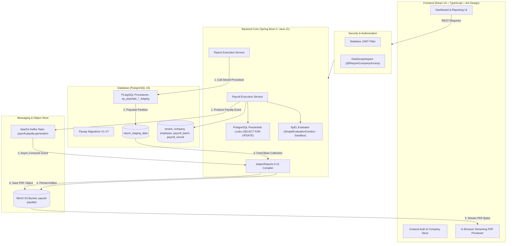

# 🏢 Multi-Tenant Payroll & Statutory Document Platform

[](https://www.oracle.com/java/)
[](https://spring.io/projects/spring-boot)
[](https://react.dev/)
[](https://www.typescriptlang.org/)
[](https://www.postgresql.org/)
[](https://kafka.apache.org/)
[](https://min.io/)
[](https://community.jaspersoft.com/)
[](LICENSE)

> A full-stack payroll calculation, statutory compliance, and document generation platform built with **Java 21, Spring Boot 3, PostgreSQL, Apache Kafka, MinIO, JasperReports**, and **React 19 + TypeScript**.

---

## 📌 Overview

This platform handles multi-subsidiary corporate payroll operations (seeded for Indian statutory requirements with subsidiaries like *Acme India Ltd* and *Aj Pvt Ltd*). It provides:

- **Entity & Company Scoping**: Data access restricted via custom Spring AOP security interceptors.
- **Formula-Driven Compensation Engine**: Configurable earnings and statutory deductions evaluated securely using Spring SpEL data-binding sandboxes.
- **Asynchronous Payslip Pipeline**: Batch payroll execution that offloads heavy JasperReports document rendering to background **Apache Kafka** consumers.
- **Staging-Backed Reporting Engine**: Real-world snapshot reporting where PostgreSQL stored procedures stage data into `report_staging_data`, filled into pre-compiled Jasper templates, saved to **MinIO**, and streamed into an in-browser PDF preview.

---

## 🏗️ System Architecture



---

## ⚙️ Core Technical Implementation

### 1. Secure Formula-Driven Calculations (Spring SpEL Sandbox)
- Salary components (Basic Pay, HRA, Provident Fund) are stored with configurable formula expressions (e.g. `#BASE_SALARY * 0.40`).
- **Security**: Formulas are evaluated via [`SpelFormulaEvaluatorService.java`](enterprise-payroll-api/src/main/java/com/payroll/aj/payroll/engine/SpelFormulaEvaluatorService.java) using Spring's `SimpleEvaluationContext.forReadOnlyDataBinding()`.
  > **Note**: Unlike `StandardEvaluationContext`, `SimpleEvaluationContext` restricts evaluation strictly to read-only variable data binding. Java reflection, class loader invocation (`T(...)`), and arbitrary method execution are completely blocked.

### 2. Batch Payroll Processing & Concurrency Control
- Monthly runs are initiated per company through [`PayrollExecutionService.java`](enterprise-payroll-api/src/main/java/com/payroll/aj/payroll/service/PayrollExecutionService.java).
- **Pessimistic Locking**: Concurrent runs for the same period are prevented via JPA database-level locks (`@Lock(LockModeType.PESSIMISTIC_WRITE)`).
- **Asynchronous Offloading**: Once calculations are committed to PostgreSQL, the service publishes lightweight `PayslipGenerationEvent` messages to the Kafka topic `payroll.payslip.generation`.

### 3. Asynchronous Payslip Generation via Apache Kafka
- [`PayslipGenerationConsumer.java`](enterprise-payroll-api/src/main/java/com/payroll/aj/payroll/event/PayslipGenerationConsumer.java) listens on the Kafka topic, loads line items, compiles Jasper PDFs, and uploads the files to MinIO.
- **Deterministic Storage Keys**: Payslips are stored under deterministic paths:
  `tenants/{tenantId}/companies/{companyId}/{year}/{month}/{employeeCode}_payslip.pdf`
  This guarantees that event retries overwrite the exact object key rather than creating duplicate files.

### 4. Staging Table Reporting Pipeline (Enterprise Pattern)
For on-demand management reports (Payslips, Payroll Register, Headcount & Cost):
1. **Dynamic Parameter Selection**: User chooses report code and filters (company, completed batch, employee).
2. **PL/pgSQL Staging**: The backend invokes a stored procedure (`sp_populate_payslip_staging`, `sp_populate_payroll_summary_staging`, or `sp_populate_headcount_cost_staging`).
3. **Partition Isolation**: Staged data rows are tagged with a unique `job_id` UUID in [`report_staging_data`](enterprise-payroll-api/src/main/resources/db/migration/V7__reporting_tables.sql).
4. **Jasper Compilation**: Pre-compiled JRXML templates format the staged bean data into high-resolution PDFs.
5. **Streaming Preview & Download**: The PDF is uploaded to MinIO and streamed directly to the frontend `<iframe />` with an instant **Export PDF** button.

---

## 🛠️ Technology Stack

| Component | Technology | Role in Project |
|---|---|---|
| **Language** | Java 21 | Modern Java records, pattern matching, strong typing |
| **Backend Framework** | Spring Boot 3.4+ | Core REST API, Spring Security 6, Spring Data JPA, Spring Kafka |
| **Database** | PostgreSQL 16 | Relational persistence, PL/pgSQL stored procedures & indexes |
| **Schema Migrations** | Flyway | Versioned migrations (V1 to V7) |
| **Message Broker** | Apache Kafka | Decouples bulk payroll calculation from PDF rendering |
| **Document Engine** | JasperReports 6.21 | Pre-compiled XML templates for statutory PDF generation |
| **Object Storage** | MinIO | S3-compatible local bucket (`payroll-payslips`) for PDF artifacts |
| **Frontend UI** | React 19 + TypeScript | Strict typing, Vite build tool, modern Hooks architecture |
| **UI Components** | Ant Design 5 | Component system with customized light theme |

> *Note on Redis*: `spring-boot-starter-data-redis` and a Redis container are configured in the infrastructure stack for session/cache extension. Authentication is currently implemented as stateless JWT (HMAC-SHA), and batch concurrency is guarded by PostgreSQL pessimistic write locks.

---

## 🗄️ Database Architecture & Migrations

- **`V1__init_schema.sql`**: Core multi-tenant tables (`tenant`, `country`, `company`, `department`, `employee`, `app_user`).
- **`V2__salary_components.sql`**: Salary components, formulas, and employee salary structure mappings.
- **`V3__payroll_execution.sql`**: `payroll_batch`, `payroll_record`, and detail line items with state machine (`DRAFT` &rarr; `PENDING` &rarr; `PROCESSING` &rarr; `COMPLETED`).
- **`V4__seed_data.sql`**: Seed data for Acme India Ltd with active employees and Indian statutory components (Basic Pay, HRA, PF).
- **`V5__company_hr_support.sql`**: Subsidiary-level user scoping (`COMPANY_HR` vs `SUPER_ADMIN`).
- **`V6__aj_pvt_ltd_seed.sql`**: Seed dataset for second subsidiary: **Aj Pvt Ltd** in Bangalore.
- **`V7__reporting_tables.sql`**: Table `report_staging_data` and procedures `sp_populate_payslip_staging`, `sp_populate_payroll_summary_staging`, and `sp_populate_headcount_cost_staging`.

---

## 📄 Available Reports

| Report Code | Title | Category | Staging Procedure | Output |
|---|---|---|---|---|
| `EMP_PAYSLIP` | **Employee Monthly Payslip** | Payroll | `sp_populate_payslip_staging` | PDF |
| `PAYROLL_SUMMARY` | **Company Payroll Master Register** | Audit & Financials | `sp_populate_payroll_summary_staging` | PDF |
| `HEADCOUNT_COST` | **Department Cost & Headcount** | Analytics | `sp_populate_headcount_cost_staging` | PDF |

---

## 🚦 Getting Started

### Prerequisites
- **JDK 21** installed
- **Node.js 18+** & npm installed
- **Docker** running

### 1. Start Infrastructure Containers
```bash
docker run -d --name payroll_db -p 5433:5432 -e POSTGRES_DB=payroll_db -e POSTGRES_USER=payroll_admin -e POSTGRES_PASSWORD=changeme postgres:16
docker run -d --name payroll_redis -p 6379:6379 redis:7-alpine
docker run -d --name payroll_kafka -p 9092:9092 -e KAFKA_CFG_NODE_ID=1 -e KAFKA_CFG_PROCESS_ROLES=broker,controller -e KAFKA_CFG_LISTENERS=PLAINTEXT://:9092,CONTROLLER://:9093 -e KAFKA_CFG_ADVERTISED_LISTENERS=PLAINTEXT://localhost:9092 -e KAFKA_CFG_LISTENER_SECURITY_PROTOCOL_MAP=CONTROLLER:PLAINTEXT,PLAINTEXT:PLAINTEXT -e KAFKA_CFG_CONTROLLER_QUORUM_VOTERS=1@localhost:9093 -e KAFKA_CFG_CONTROLLER_LISTENER_NAMES=CONTROLLER bitnami/kafka:latest
docker run -d --name payroll_minio -p 9000:9000 -p 9001:9001 -e MINIO_ROOT_USER=minioadmin -e MINIO_ROOT_PASSWORD=minioadmin minio/minio server /data --console-address ":9001"
```

### 2. Run Backend API
```bash
cd enterprise-payroll-api
mvn clean package -DskipTests
java -jar target/aj-0.0.1-SNAPSHOT.jar
```
*Tomcat starts on port `8080`, Flyway migrations run automatically, and Jasper templates compile on startup.*

### 3. Run Frontend UI
```bash
cd enterprise-payroll-ui
npm install
npm run dev
```
*Vite dev server starts on `http://localhost:5173`.*

---

## 🔐 Local Demo Credentials

> *These credentials and container passwords (`changeme`, `minioadmin`) are provided for local development and demonstration testing.*

| Role | Username / Login | Password | Access Scope |
|---|---|---|---|
| **Super Admin** | `admin` *(admin@acme.com)* | `password123` | Global (All Companies & Features) |
| **HR Manager India** | `hr_india` *(hr_india@acme.com)* | `password123` | Scoped to Acme India & Aj Pvt Ltd |

---

## 📡 REST API Summary

| Method | Endpoint | Description |
|---|---|---|
| `POST` | `/api/v1/auth/login` | Authenticate operator & issue JWT token |
| `GET` | `/api/v1/companies/{companyId}/dashboard` | Real-time payroll & headcount stats |
| `GET` | `/api/v1/companies/{companyId}/employees` | Search and list company employees |
| `POST` | `/api/v1/companies/{companyId}/payroll/run` | Trigger monthly payroll batch calculation |
| `GET` | `/api/v1/companies/{companyId}/payroll/batches` | List historical completed payroll batches |
| `GET` | `/api/v1/reports/catalog` | Fetch catalog of available statutory reports |
| `POST` | `/api/v1/reports/execute` | Run staging procedure and generate report artifact |
| `GET` | `/api/v1/reports/preview/{jobId}` | Stream PDF binary for in-browser iframe preview |
| `GET` | `/api/v1/reports/download/{jobId}` | Download exported report PDF |

---

## 🛡️ License

This project is licensed under the [MIT License](LICENSE).
